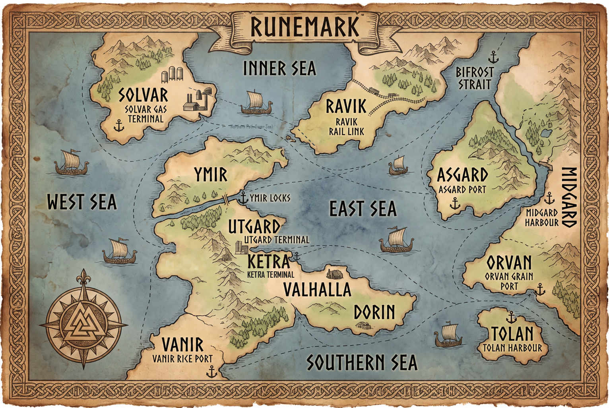

# Trial of the Nine Realms — Supply Chain Disruption Intelligence Challenge

## The Mission

A supply chain disruption has been reported across the Runemark trade network. Most AI tools only summarize the news — sourced facts and speculation get blended together, and decision-makers cannot tell what is certain and what is disputed.

Your task is to build an adversarial multi-agent courtroom system that treats every disruption as a court case. The system must ingest the document corpus, verify the event is real, debate the commercial exposure from two opposing sides, and deliver a structured intelligence briefing with every claim graded by nature and confidence.

There is no spoon-fed answer. You and your team must design the architecture, retrieve the right evidence, challenge each other's claims, and prove your system's reasoning from the raw documents.

---

## Commercial Value vs. Physical Disruption

Alarming news or transit drops do not automatically mean a large trade value collapse. Alternative routing, carrier consolidation, and price/freight adjustments often cushion commercial exposure. Your courtroom agents must evaluate actual net value impact, not assume all crises cause massive drops.

---

## Folder Layout

```text
dev_pack_E5/
├── README.md                  ← You are here
├── manifest.json              ← Document catalog (IDs, dates, formats, sectors)
├── hashes.sha256              ← File integrity checksums
├── sample_question.txt        ← The target query in plain text
└── docs/                      ← The document pool (76 files: TXT, PDF, DOCX)
    ├── ATL-0001 to ATL-0016   # Runemark Atlas — geography, country profiles, trade routes & outlet credibility tiers
    ├── ORV-0001 to ORV-0050   # Regional agricultural notices, customs filings, port bulletins & industry reports
    └── WLD-0021 to WLD-0030   # General newswire: public affairs, cultural dispatches & civic reporting
```

---

## What Your System Must Uncover

A successful system must autonomously solve challenges across the document pool:

* **Event Verification:** Heimdall must confirm the disruption event is real and active as of the as-of date (**25 January 2027**). Fake decoys, retracted notices, and planted injections exist in the corpus and must be caught before the trial begins.
* **Opposing Exposure Cases:** Thor and Loki must each build a document-grounded case on opposite sides — high exposure vs. limited exposure — covering the specified commercial trade flows. Vague positions are not valid claims.
* **Cross-Examination & Concessions:** Each side must attack the other's weakest claims with counter-evidence. Agents must either defend with new documents or concede. A system where no one ever concedes has not genuinely debated.
* **Judicial Classification:** Odin must distinguish between sourced facts (directly stated in a document) and inferences (derived by reasoning). Every claim must receive a ruling and be classified as Established, Contested, or Conceded.
* **Sufficiency Loop:** If the evidence base is thin after the first trial run, Odin returns it for a second round of retrieval. A minimum of two trial runs must be demonstrated.
* **Final Intelligence Briefing & Human-Readable Deliverable:** Odin authors the final briefing from his rulings only — not from Thor or Loki's raw arguments. The briefing must include an exposure table (with separate Thor, Loki, and Odin ranges), inline paragraph-level citations, and a next-quarter outlook. In your user interface (UI), this briefing must be rendered cleanly for human decision-makers.
* **Source Hygiene:** The corpus contains documents from four outlet credibility tiers (see `ATL-0012`). Your system must not treat a tabloid rumour or a retracted notice as established fact. The as-of date is **25 January 2027** — citing anything published after this date is a clock violation.

---

## Submission Deliverables

Submit a final output and an execution trace, in any format. Label each item with the question it answers.

**Final output**
- Event Verification
- Exposure Ranges
- Odin's Executive Briefing

**Execution trace**
- Agent queries and retrieved document IDs
- Cross-examination challenges and counter-arguments
- Memory updates and claim concessions
- Judicial rulings per round

**This is the bare minimum, not the full goal.** Go further: add more results, add more detail to your execution trace, and show your creativity. But every finding must come from the document pool and be retrieved by your agent at run time. Missing any item above is a serious penalty that extras cannot cancel.

---

## Evaluation

Submissions are evaluated on:
* **Citation Validity** — Grounded evidence from verified documents.
* **Range Accuracy** — Precise commercial exposure bounds.
* **Calibration** — Well-calibrated confidence intervals.
* **Trap Handling** — Robustness against adversarial noise.
* **Quality of Debate** — Genuine cross-examination and concessions.
* **Pipeline Reliability** — Stable end-to-end execution.
* **Reproducibility** — Consistent multi-round trial results.
* **Briefing & UI Presentation** — Executive briefing and interface.

---

## Attribution

The Runemark world, nations, trade routes, and document corpus are entirely fictional and created for this challenge. All companies, trade figures, and events are simulated.

The outlet credibility tier model in `ATL-0012` is inspired by standard source reliability frameworks used in intelligence and investigative journalism contexts.

*This dataset is for educational and competition use only.*

---

### Runemark World Map



> **⚠️ Human Reference Only — Do Not Pass to Agents.**
> This map is provided solely to help human developers visualise the geographic layout of the Runemark nations, seas, ports, and trade routes. It must **not** be passed as input or context to any agent, model, or retrieval pipeline. All geographic and routing facts used by your system must be sourced from the document corpus at run time.
